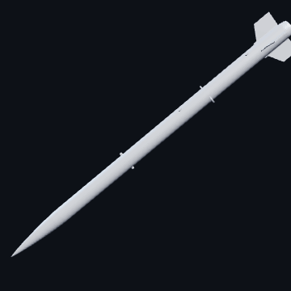
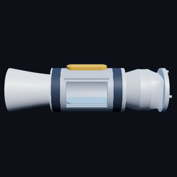
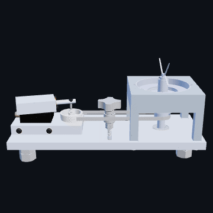
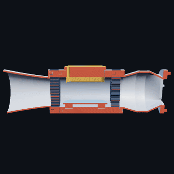

# Engineering CAD

3D models from my mechanical and aerospace engineering projects at the University
of Florida. GitHub shows `.stl` files as interactive models: open any file below,
then drag to rotate and scroll to zoom.

Full write-ups, photos and design reports are on [orialgave.com](https://orialgave.com).

|  |  |
|:-:|:-:|
| IREC competition rocket | Modular desktop wind tunnel |
|  |  |
| eVTOL airframe | Air-engine mixer assembly |

## Swamp Launch rocket design and CFD

*Swamp Launch Rocket Team · Aerosciences / Staging Engineer · Aug 2025 to present*

ANSYS Fluent CFD on HiPerGator with drag within 15% of RASAero, validated on a
dual-load-cell wind-tunnel rig. I built the IREC competition vehicle in SolidWorks.
That CAD model became the basis for both the CFD study and the wind-tunnel test
planning, so the simulation and the physical test were checking the same shape.

| Model | |
|---|---|
| [IREC competition rocket](models/swamp-launch-competition-rocket.stl) | The full vehicle |
| [Wind-tunnel test assembly](models/swamp-launch-wind-tunnel-assembly.stl) | The rocket model on its test mount |

[Project page](https://orialgave.com/portfolio/swamp-launch-rocket-design-cfd)

## Modular desktop wind tunnel

*Personal project · May to September 2025*

Designed and built a working wind tunnel from scratch over 80+ hours of SolidWorks
CAD. The nozzle, diffuser and test-section geometry were refined with guidance from
aerodynamic literature, so the intake, test section and exhaust work together as one
flow path. Air enters through the intake cone, which contracts it toward the test
section, then passes a honeycomb connector that straightens it before it reaches the
model. The test section carries an LED bar and a model mount, with a second honeycomb
downstream before the exhaust tube. The assembly is about 71 cm long and 20 cm across,
built from seven separate parts.

| Model | |
|---|---|
| [Full assembly](models/modular-wind-tunnel-assembly.stl) | Intake cone, honeycomb connectors, test section, LED bar and exhaust tube |
| [Cutaway](models/modular-wind-tunnel-cutaway.stl) | Cut along the centerline to show the flow path |

[Project page](https://orialgave.com/portfolio/modular-desktop-wind-tunnel)

## Air-engine mixer

*EML2322L Design and Manufacturing Laboratory · Summer 2026*

Machined a running compressed-air engine and engineered the attachment that turns it
into a variable-speed mason-jar mixer, from raw stock through a full
design-for-manufacturing package. I machined the base, flywheel, piston and piston
block, and designed the selected concept.

| Model | |
|---|---|
| [Compressed-air engine](models/air-engine.stl) | Base, flywheel, piston and piston block |
| [Full mixer assembly](models/air-engine-mixer-assembly.stl) | Air engine, flat-belt drive, stepped drive shaft, bearing tensioner, PETG H-Block and twist-lock jar interface |

[Project page](https://orialgave.com/portfolio/air-engine-mixer)

## Design/Build/Fly eVTOL aircraft

*Gator Design/Build/Fly · Aerodynamics / Manufacturing Engineer · Aug 2025 to present*

Cut airframe drag 18% and body weight 34% through geometry optimization and
carbon-fiber fabrication. I manufacture airframe structure, including the carbon-fiber
fuselage, with positive carbon-fiber molding.

| Model | |
|---|---|
| [eVTOL aircraft](models/dbf-evtol-plane.stl) | The competition airframe |

[Project page](https://orialgave.com/portfolio/design-build-fly-aircraft)

## About the files

The models were exported from SolidWorks for the web. The two assemblies were
simplified to keep them light enough to view in a browser, so they are for viewing
and not for manufacturing. Team projects belong to their teams. The text above
says which part of each I did.
